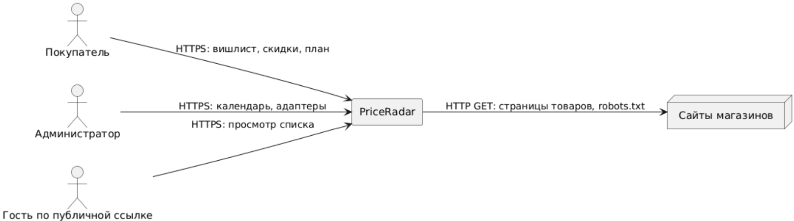
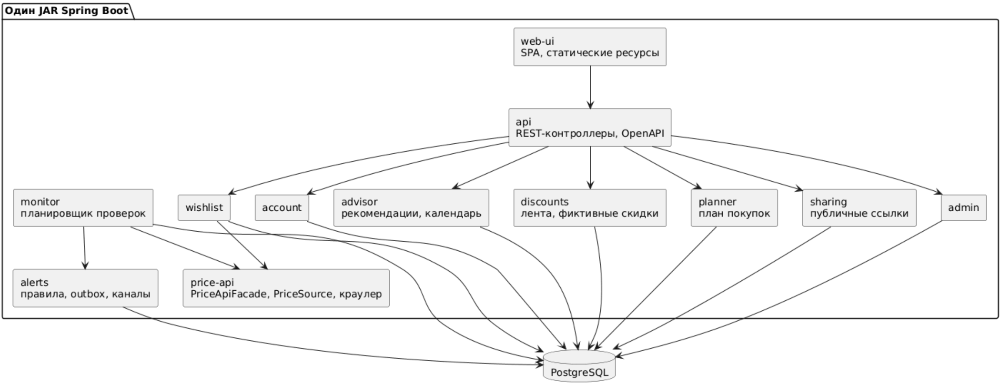
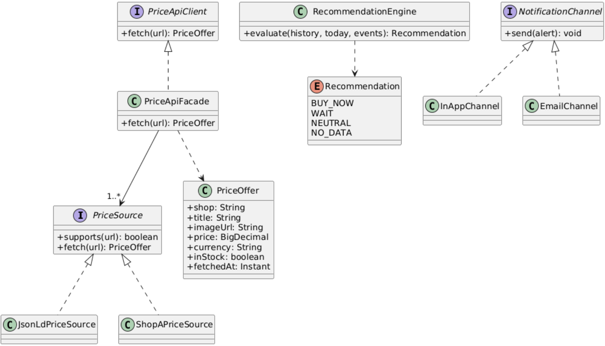
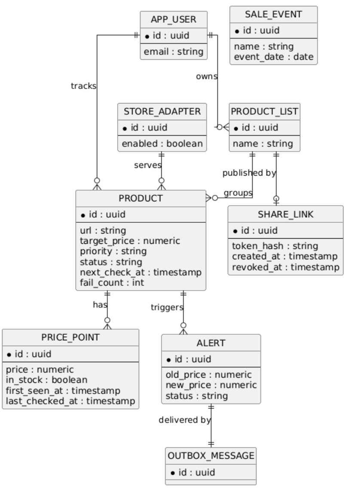
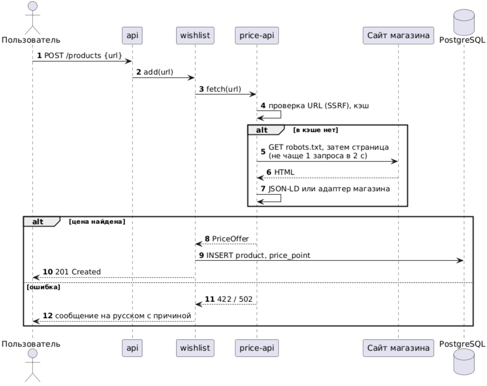
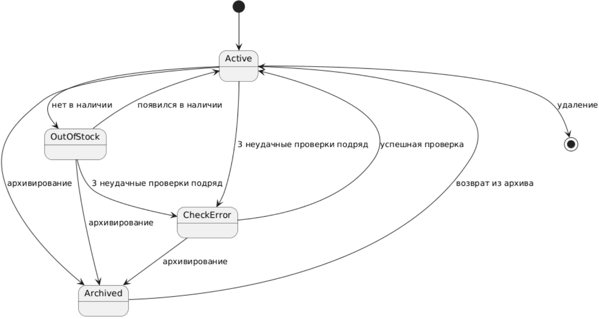
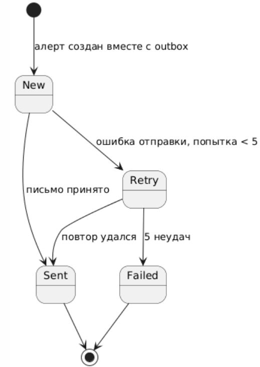
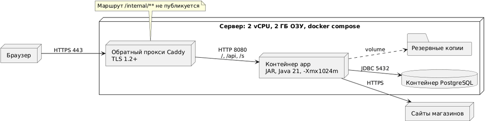

# Описание дизайна программного обеспечения

Для PriceRadar — агрегатора скидок и умного планировщика покупок

Версия 0.1

Подготовил Аникевич Павел Петрович

Белорусский государственный университет информатики и радиоэлектроники, кафедра ЭВМ

2026-11-01

## Оглавление

* [1. Введение](#1-введение)
  * [1.1 Назначение документа](#11-назначение-документа)
  * [1.2 Область применения](#12-область-применения)
  * [1.3 Определения, акронимы и сокращения](#13-определения-акронимы-и-сокращения)
  * [1.4 Ссылки](#14-ссылки)
  * [1.5 Обзор документа](#15-обзор-документа)
* [2. Обзор дизайна](#2-обзор-дизайна)
  * [2.1 Задачи стейкхолдеров](#21-задачи-стейкхолдеров)
  * [2.2 Выбранные точки зрения](#22-выбранные-точки-зрения)
* [3. Проектные представления](#3-проектные-представления)
* [4. Решения](#4-решения)
* [5. Приложения](#5-приложения)

## История изменений

| Name | Date | Reason For Changes | Version |
|------|------|--------------------|---------|
| Аникевич Павел Петрович | 2026-11-01 | Первая версия документа по SRS 0.1 | 0.1 |
| Аникевич Павел Петрович | 2026-11-03 | Добавлены Price API (REQ-INT-009) и публичные ссылки на списки (REQ-FUNC-025/026); представления 004–007, 012; ADR-006 | 0.2 |
| Аникевич Павел Петрович | 2026-11-09 | Добавлена модель динамического поведения (ЛР5): представления 014–016, обновлены 007 и 009; ADR-007 | 0.3 |

---

## 1. Введение

Документ описывает, как PriceRadar реализует требования из `docs/srs/srs.md`: границы системы, модули, данные, интерфейсы, ключевые алгоритмы, параллельную обработку и развёртывание.

### 1.1 Назначение документа

SDD связывает требования SRS с проектными решениями. Разработчики используют его как основу реализации, тестировщики — для подготовки интеграционных проверок, сопровождающий — для понимания работы фоновых задач и развёртывания. Документ опирается на SRS (версия 0.2 после ЛР4) и протоколы архитектурных решений в каталоге `docs/adr`.

### 1.2 Область применения

Проектируется PriceRadar версии 0.1 (MVP) с последующими инкрементами 0.2 и 1.0 из раздела 2.6 SRS: веб-приложение на Java 21 и Spring Boot с хранением данных в PostgreSQL. Система принимает ссылки на товары интернет-магазинов, через собственный Price API получает цены, ведёт историю, отправляет алерты, считает рекомендации «купить сейчас / подождать», формирует ленту скидок, план покупок и публичные ссылки на списки.

Не входят в область: мобильные приложения, автоматическая покупка, сопоставление одинаковых товаров в разных магазинах, расширение для браузера, публичный каталог скидок.

### 1.3 Определения, акронимы и сокращения

| Term | Definition |
|------|------------|
| ADR | Architecture Decision Record — протокол архитектурного решения |
| API | Application Programming Interface — программный интерфейс |
| Price API | Собственный внутренний REST-интерфейс получения нормализованных цен по URL товара (REQ-INT-009) |
| PriceSource | Java-интерфейс адаптера магазина, извлекающего данные со страницы |
| Outbox | Таблица исходящих сообщений, записываемых в одной транзакции с бизнес-данными и доставляемых отдельным обработчиком |
| SDD | Software Design Description — описание дизайна ПО |
| SKIP LOCKED | Режим блокировки строк PostgreSQL, пропускающий строки, уже захваченные другими транзакциями |
| SRS | Software Requirements Specification — спецификация требований к ПО |
| SSRF | Server-Side Request Forgery — вынуждение сервера обратиться по подставленному адресу |
| Публичная ссылка | URL со случайным токеном, открывающий список только для чтения без входа |

### 1.4 Ссылки

- Спецификация требований к ПО PriceRadar, `docs/srs/srs.md`, версия 0.2 (нормативная).
- Протоколы ADR-001…ADR-006, каталог `docs/adr` (нормативные).
- Шаблон `templates/sdd/sdd-template.md` кафедры ЭВМ БГУИР (нормативная).
- Шаблон `templates/adr/adr-template.md` (MADR, адаптированный) (нормативная).
- ISO/IEC/IEEE 42010:2022 Architecture description (справочная).
- RFC 9309 Robots Exclusion Protocol (нормативная).
- OpenAPI Specification 3.0 (справочная).

### 1.5 Обзор документа

Раздел 2 перечисляет стейкхолдеров и выбранные точки зрения. Раздел 3 содержит проектные представления с идентификаторами вида `NNN-название`; каждое указывает требования SRS, которые оно реализует, и связанные ADR. Раздел 4 кратко описывает принятые решения со ссылками на полные ADR. Раздел 5 содержит приложения. Изменения документа фиксируются в истории изменений.

---

## 2. Обзор дизайна

Система — модульный монолит: один исполняемый JAR с веб-интерфейсом (SPA как статические ресурсы), REST API, фоновыми обработчиками и модулем Price API; данные хранятся в одной базе PostgreSQL (ADR-001, ADR-002). Получение цен вынесено в отдельный модуль с собственным API, чтобы остальные модули не зависели от способа извлечения данных (ADR-003).

### 2.1 Задачи стейкхолдеров

| Стейкхолдер | Основные задачи | Представления |
|-------------|-----------------|---------------|
| Покупатель, охотник за скидками | быстрое добавление товара, своевременные алерты, понятная рекомендация, приватность данных | 001, 006, 007, 008, 009 |
| Администратор | управление календарём распродаж и адаптерами магазинов | 002, 006 |
| Заказчик | соответствие требованиям, сроки, стоимость, предсказуемость поведения | 001, 002, 011 |
| Разработчик | чёткие границы модулей, расширяемость списка магазинов, тестируемость | 002, 003, 004, 011 |
| Тестировщик | проверяемые контракты, воспроизводимые сценарии, эталонные данные | 006, 007, 008 |
| Оператор (владелец сервера) | простое развёртывание, ограниченные ресурсы, восстановление, наблюдаемость | 012, 013 |
| Владельцы магазинов (внешняя сторона) | отсутствие чрезмерной нагрузки на сайты | 010, 013 |

### 2.2 Выбранные точки зрения

| Точка зрения | Применение | Язык | Представление |
|--------------|------------|------|---------------|
| Контекст | границы системы и акторы | диаграмма C4 (Mermaid) | 001 |
| Композиция | модули и их ответственность | диаграмма компонентов | 002 |
| Зависимости | допустимые связи модулей | граф зависимостей | 003 |
| Логическое представление | ключевые типы и интерфейсы | диаграмма классов | 004 |
| Информация | постоянные данные | диаграмма «сущность-связь» | 005 |
| Интерфейс | REST API и контракт Price API | таблицы маршрутов, JSON | 006 |
| Взаимодействие | добавление товара, доставка алерта | диаграммы последовательности | 007 |
| Алгоритм | рекомендация, фиктивная скидка, план покупок | псевдокод | 008 |
| Динамика состояний | товар, алерт, публичная ссылка | диаграммы состояний | 009 |
| Параллелизм | планировщик, ограничение частоты, outbox | описание и таблица | 010 |
| Паттерны | применённые шаблоны проектирования | таблица | 011 |
| Развёртывание | узлы и связи | диаграмма развёртывания | 012 |
| Ресурсы | память, соединения, потоки | таблица распределения | 013 |
| Прецеденты | функции системы и актёры | диаграмма вариантов использования | 014 |
| Активность | потоки прецедентов | диаграммы активности (PlantUML) | 015 |
| Последовательность (динамика) | сообщения между модулями | диаграммы последовательности (PlantUML) | 016 |

Точки зрения «Физическое представление» и «Структура» отдельно не выделены: физическая инфраструктура — один сервер (см. 012), внутреннее устройство компонентов раскрыто в 002 и 004.

---

## 3. Проектные представления

### 001-context

- **ID**: 001-context
- **Title**: Контекст системы PriceRadar
- **Viewpoint**: Контекст
- **Representation**:



  Система предоставляет сервисы: ведение вишлиста, получение цен, алерты, рекомендации, ленту скидок, план покупок, публикацию списка. Внешние системы — сайты магазинов (источник данных).
- **More Information**: SRS 1.2, 2.1; REQ-INT-005, REQ-INT-009, REQ-COMP-001, REQ-FUNC-025.

### 002-composition

- **ID**: 002-composition
- **Title**: Состав модулей
- **Viewpoint**: Композиция
- **Representation**:



  Ответственность: `account` — регистрация, вход, сессии; `wishlist` — товары и списки; `price-api` — единственная точка получения цен (адаптеры, robots.txt, ограничение частоты, SSRF-защита, кэш); `monitor` — периодические проверки и история цен; `alerts` — правила, дедупликация и доставка; `advisor` — чистая библиотека правил рекомендации без зависимости от web и БД; `discounts`, `planner` — производные представления; `sharing` — публичные ссылки; `admin` — календарь и включение адаптеров.
- **More Information**: SRS 2.2, 3.5.5; ADR-001, ADR-003; REQ-FUNC-001…026.

### 003-dependency

- **ID**: 003-dependency
- **Title**: Допустимые зависимости модулей
- **Viewpoint**: Зависимости
- **Representation**: направление «использует»; обратные и циклические зависимости запрещены.

| Модуль | Использует | Не должен использовать |
|--------|-----------|------------------------|
| api | account, wishlist, advisor, discounts, planner, sharing, admin | monitor, price-api (напрямую) |
| wishlist | price-api (интерфейс `PriceApiClient`), БД | monitor, alerts |
| monitor | price-api, alerts, БД | api, web-ui |
| alerts | БД, почтовый шлюз | price-api |
| advisor | только стандартную библиотеку Java | Spring, БД, web |
| discounts, planner | advisor, БД | price-api |
| sharing | wishlist (чтение), БД | alerts, advisor |
| price-api | HTTP-клиент, кэш | любые модули предметной области |

  Правила проверяются архитектурным тестом (ArchUnit, см. ADR-001, «Подтверждение»).
- **More Information**: REQ-MAINT-001; ADR-001, ADR-003.

### 004-logical

- **ID**: 004-logical
- **Title**: Ключевые типы и интерфейсы
- **Viewpoint**: Логическое представление
- **Representation**:



- **More Information**: REQ-MAINT-001, REQ-INT-009, REQ-FUNC-014, REQ-FUNC-019; ADR-003.

### 005-information

- **ID**: 005-information
- **Title**: Информационная модель
- **Viewpoint**: Информация
- **Representation**:



  Целостность: уникальность `(product_id, price, in_stock)` для последней записи истории не требуется — запись обновляется по правилу REQ-FUNC-009; `share_link.token_hash` уникален; удаление пользователя каскадно удаляет данные (REQ-COMP-002); `next_check_at` индексируется для выборки задач (ADR-004).
- **More Information**: REQ-FUNC-005…016, REQ-FUNC-025, REQ-COMP-002; ADR-004, ADR-005, ADR-006.

### 006-interface

- **ID**: 006-interface
- **Title**: Внешние и внутренний интерфейсы
- **Viewpoint**: Интерфейс
- **Representation**: публичный REST API (JSON, спецификация `/v3/api-docs`) и внутренний Price API.

| Метод и маршрут | Назначение | Требования |
|-----------------|-----------|------------|
| `POST /api/v1/auth/register`, `/login`, `/logout` | учётная запись | REQ-FUNC-001/002 |
| `GET/POST /api/v1/products`, `PATCH/DELETE /api/v1/products/{id}` | вишлист | REQ-FUNC-003…006 |
| `GET/POST /api/v1/lists` | списки | REQ-FUNC-007 |
| `GET /api/v1/products/{id}/history?days=` | график и CSV | REQ-FUNC-021/023 |
| `GET /api/v1/discounts`, `GET /api/v1/plan?budget=` | лента, план | REQ-FUNC-017/022 |
| `PUT/DELETE /api/v1/lists/{id}/share` | создать/отозвать публичную ссылку | REQ-FUNC-025 |
| `GET /s/{token}` | публичный просмотр списка | REQ-FUNC-026, REQ-SEC-007 |
| `PUT /api/v1/admin/sale-events`, `/adapters/{id}` | администрирование | REQ-FUNC-024 |

  **Price API** (внутренний, заголовок `X-Service-Key`, REQ-SEC-006):

```
POST /internal/v1/prices/fetch
{ "url": "https://shop.example/item/123" }

200 OK
{ "shop": "shop-a", "title": "Наушники X", "imageUrl": "https://…/x.jpg",
  "price": 189.90, "currency": "BYN", "inStock": true,
  "fetchedAt": "2026-11-20T10:15:00Z", "source": "json-ld", "cached": false }
```

| Код | Условие |
|-----|---------|
| 401 | нет или неверный сервисный ключ |
| 400 | некорректный URL или запрещённая схема/адрес (SSRF) |
| 422 | магазин не поддерживается или цена не найдена на странице |
| 429 | превышен лимит запросов к домену, указан `Retry-After` |
| 502/504 | магазин недоступен или не ответил за 10 с |

- **More Information**: REQ-INT-006, REQ-INT-009, REQ-SEC-006; ADR-003.

### 007-interaction

- **ID**: 007-interaction
- **Title**: Добавление товара по ссылке через Price API
- **Viewpoint**: Взаимодействие
- **Representation**:



  Путь отказа: неподдерживаемый домен возвращает 422 и список магазинов (REQ-FUNC-004). Доставка алерта описана в ADR-005: запись алерта и outbox в одной транзакции, затем обработчик отправляет письмо с повторами.
- **More Information**: REQ-FUNC-003/004, REQ-INT-009, REQ-SEC-004; ADR-003, ADR-005.

### 008-algorithm

- **ID**: 008-algorithm
- **Title**: Рекомендация, фиктивная скидка и план покупок
- **Viewpoint**: Алгоритм
- **Representation**: модуль `advisor`, детерминированные правила.

```
recommend(history, today, events):
    h = history за последние 90 дней
    if дней_истории(h) < 14 or len(h) < 5: return NO_DATA
    min90 = min(price); med90 = median(price)
    trend = наклон линейной регрессии цены за 14 дней, % в неделю
    next  = ближайшее событие календаря после today
    if price_now <= 1.05 * min90: return BUY_NOW
    if trend <= -1 or (next.days <= 30 and price_now > med90): return WAIT
    return NEUTRAL      # обоснование включает min90, med90, trend, next

is_fake_discount(h):
    peak = max цена в окне перед снижением
    return peak >= 1.20 * med90 and price_now >= med90

plan(budget, items):  # жадный выбор
    items с рекомендацией BUY_NOW, по убыванию приоритета, затем по цене
    сумма = 0; выбранные = []
    for i in items: if сумма + i.price <= budget: добавить
    return выбранные, budget - сумма
```

  Сложность: O(n) по истории (n ≤ 365 записей) и O(m log m) по числу товаров для плана; расчёт одного товара укладывается в 300 мс (REQ-PERF-004).
- **More Information**: REQ-FUNC-018/019/020/022, REQ-PERF-004.

### 009-state-dynamics

- **ID**: 009-state-dynamics
- **Title**: Состояния товара, алерта и публичной ссылки
- **Viewpoint**: Динамика состояний
- **Representation**:





  Публичная ссылка: `нет → активна → отозвана`; пересоздание создаёт новый токен, прежний перестаёт работать.
- **More Information**: REQ-FUNC-006/010/011, REQ-REL-002, REQ-FUNC-025.

### 010-concurrency

- **ID**: 010-concurrency
- **Title**: Параллельная обработка
- **Viewpoint**: Параллелизм
- **Representation**:

| Элемент | Решение |
|---------|---------|
| Выборка проверок | `SELECT … WHERE next_check_at <= now() FOR UPDATE SKIP LOCKED LIMIT n`, пул из 4 рабочих потоков |
| Ограничение частоты | одна очередь токенов на домен: не более 1 запроса в 2 с, общая для всех потоков |
| Сбой магазина | повторы 1, 2, 4 мин; ошибка изолирована от других товаров |
| Алерты | outbox-обработчик в одном потоке, повторы до 5 раз, переживает перезапуск |
| Конкурентные правки | оптимистичная блокировка (`version`) для товара и списка |
| Публичные ссылки | лимит 60 запросов в минуту с IP в памяти (сброс при перезапуске допустим) |

- **More Information**: REQ-FUNC-008, REQ-REL-001/002, REQ-COMP-001, REQ-SEC-007; ADR-004, ADR-005.

### 011-patterns

- **ID**: 011-patterns
- **Title**: Применённые паттерны
- **Viewpoint**: Паттерны
- **Representation**:

| Паттерн | Где применён | Цель |
|---------|--------------|------|
| Adapter | `PriceSource` для каждого магазина | новый магазин без изменения ядра (REQ-MAINT-001) |
| Facade | `PriceApiFacade` | единая точка получения цен |
| Strategy | `NotificationChannel` | выбор каналов доставки (REQ-FUNC-014) |
| Transactional Outbox | алерты | гарантированная доставка (REQ-REL-002) |
| Repository | доступ к БД | изоляция SQL от предметных модулей |
| Pure Domain Library | `advisor` | повторное использование и простое тестирование |

- **More Information**: ADR-003, ADR-005.

### 012-deployment

- **ID**: 012-deployment
- **Title**: Развёртывание
- **Viewpoint**: Развёртывание
- **Representation**:



  Маршрут `/internal/**` на прокси не публикуется (REQ-SEC-006). Настройки и секреты передаются переменными окружения.
- **More Information**: REQ-INST-001, REQ-SEC-002, REQ-SEC-006, REQ-REL-003.

### 013-resources

- **ID**: 013-resources
- **Title**: Распределение ресурсов
- **Viewpoint**: Ресурсы
- **Representation**:

| Ресурс | Лимит | Обоснование |
|--------|-------|-------------|
| Куча JVM | `-Xmx1024m` | REQ-PERF-004: не более 1 ГБ |
| PostgreSQL | до 512 МБ, пул 10 соединений | остаток ОЗУ сервера |
| Рабочие потоки проверок | 4 | цикл 10 000 товаров за 6 ч при 1 запросе в 2 с на домен (REQ-PERF-003) |
| Кэш Price API | 5 минут, до 10 000 записей | REQ-PERF-005 |
| HTTP-клиент | таймаут 10 с, 1 повтор | REQ-REL-001 |
| Журналы | JSON, ротация 7 суток | REQ-OBS-001 |

- **More Information**: REQ-PERF-001…005, SRS 2.3.

### 014-use-cases
- **ID**: 014-use-cases
- **Title**: Модель вариантов использования
- **Viewpoint**: Прецеденты
- **Representation**: `../uml/img/01-usecase.png`. Актёры: Гость, Покупатель, Администратор (обобщает Покупателя), Время, Сайт магазина, Почтовый шлюз. 20 прецедентов UC-01…UC-20, описание — `docs/uml/use-cases.md`.
- **More Information**: REQ-FUNC-001…026; ADR-007.

### 015-activity
- **ID**: 015-activity
- **Title**: Диаграммы активности
- **Viewpoint**: Активность
- **Representation**: `../uml/img/02-activity-add.png` — добавление товара (UC-04, UC-05); `../uml/img/03-activity-check.png` — проверка цены и алерт (UC-17, UC-18).
- **More Information**: REQ-FUNC-003/004, 008…015; ADR-004, ADR-005, ADR-007.

### 016-sequence
- **ID**: 016-sequence
- **Title**: Диаграммы последовательности
- **Viewpoint**: Последовательность (динамика)
- **Representation**: `07-add-product.png`, `08-check-alert.png`, `09-public-list.png`. Линии жизни соответствуют модулям представления 002.
- **More Information**: REQ-FUNC-003, 012, 025, 026; ADR-003, ADR-005, ADR-006.
---

## 4. Решения

- **ID**: ADR-001
  - **Title**: Модульный монолит Spring Boot с PostgreSQL
  - **Context**: нужна структура приложения для одного разработчика, сервера 2 vCPU / 2 ГБ и бесплатного размещения
  - **Options**: модульный монолит; микросервисы; два отдельных приложения (клиент и сервер)
  - **Outcome**: выбран модульный монолит, потому что единственный вариант, укладывающийся в ограничения по ресурсам и команде
  - **More Information**: [adr-001](../adr/adr-001-architecture.md)
- **ID**: ADR-002
  - **Title**: Клиентская часть — SPA поверх REST API
  - **Context**: SRS требует REST API, через который выполнимы все операции интерфейса (REQ-INT-006); технология клиента была открытым вопросом
  - **Options**: SPA (React) на REST; серверные шаблоны; серверные шаблоны с htmx
  - **Outcome**: выбрана SPA, потому что интерфейс использует тот же API, что исключает дублирование логики
  - **More Information**: [adr-002](../adr/adr-002-client.md)
- **ID**: ADR-003
  - **Title**: Price API как отдельный модуль с фасадом и адаптерами
  - **Context**: SRS 0.1 не требовала собственного интерфейса получения цен; прямое извлечение из сервисов размывало ответственность
  - **Options**: прямой разбор страниц в сервисах; модуль Price API; отдельный микросервис
  - **Outcome**: выбран модуль Price API с внутренним REST-контрактом, потому что единая точка контроля robots.txt, частоты, SSRF и кэша
  - **More Information**: [adr-003](../adr/adr-003-price-api.md)
- **ID**: ADR-004
  - **Title**: Планирование проверок цен через очередь в БД
  - **Context**: проверки должны идти по расписанию, переживать перезапуск и не дублироваться
  - **Options**: `@Scheduled` в памяти; очередь в БД с SKIP LOCKED; брокер сообщений
  - **Outcome**: выбрана очередь в БД, потому что не требует новой инфраструктуры и сохраняет состояние
  - **More Information**: [adr-004](../adr/adr-004-scheduler.md)
- **ID**: ADR-005
  - **Title**: Доставка алертов через transactional outbox
  - **Context**: алерт не должен теряться при сбое или перезапуске (REQ-REL-002)
  - **Options**: отправка в транзакции; отправка после коммита из памяти; outbox
  - **Outcome**: выбран outbox, потому что запись алерта и сообщения атомарна
  - **More Information**: [adr-005](../adr/adr-005-outbox.md)
- **ID**: ADR-006
  - **Title**: Непрозрачный случайный токен публичной ссылки
  - **Context**: владелец делится списком по ссылке, не раскрывая приватные данные (REQ-FUNC-025/026, REQ-SEC-007)
  - **Options**: случайный токен с хэшем в БД; подписанный токен (JWT); числовой идентификатор списка
  - **Outcome**: выбран случайный токен с хранением SHA-256, потому что ссылку можно отозвать мгновенно и токен нельзя восстановить из БД
  - **More Information**: [adr-006](../adr/adr-006-share-link.md)
  - **ID**: ADR-007
  - **Title**: Динамическое поведение моделируется на UML в нотации PlantUML
  - **Context**: нужно описать поведение системы так, чтобы диаграммы хранились в git и сравнивались в diff
  - **Options**: PlantUML; Mermaid; графический редактор
  - **Outcome**: выбран PlantUML, потому что он поддерживает дорожки, составные состояния и текстовое хранение
  - **More Information**: [adr-007](../adr/adr-007-uml-dynamic.md)

---

## 5. Приложения

### 5.1 Трассировка требований к представлениям

| Требования SRS | Представления | ADR |
|----------------|---------------|-----|
| REQ-INT-005, REQ-INT-009, REQ-SEC-004, REQ-SEC-006, REQ-PERF-005, REQ-COMP-001 | 001, 002, 004, 006, 007, 010 | ADR-003 |
| REQ-FUNC-001…007 | 002, 005, 006, 007 | ADR-001, ADR-002 |
| REQ-FUNC-008…016, REQ-REL-001/002 | 005, 007, 009, 010 | ADR-004, ADR-005 |
| REQ-FUNC-017…022, REQ-PERF-004 | 004, 008 | ADR-001 |
| REQ-FUNC-023/024 | 002, 006 | — |
| REQ-FUNC-025/026, REQ-SEC-007 | 005, 006, 009, 010 | ADR-006 |
| REQ-INST-001, REQ-SEC-002, REQ-REL-003, REQ-OBS-001 | 012, 013 | ADR-001 |
| REQ-INT-001…004, REQ-INT-006 | 006 | ADR-002 |
| UC-01…UC-20 (все REQ-FUNC) | 014, 015, 016, 009 | ADR-007 |

### 5.2 Открытые вопросы

- Состав трёх поддерживаемых магазинов определяется по результатам прототипа извлечения цен (SRS 3.5.9); от него зависит число специальных адаптеров.
- Выбор почтового провайдера для SMTP выполняется при развёртывании.
